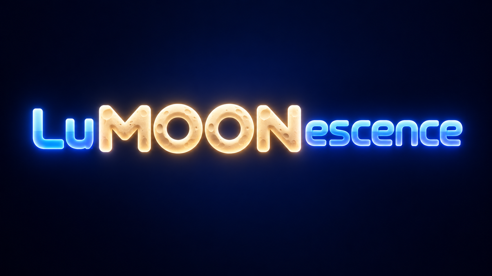
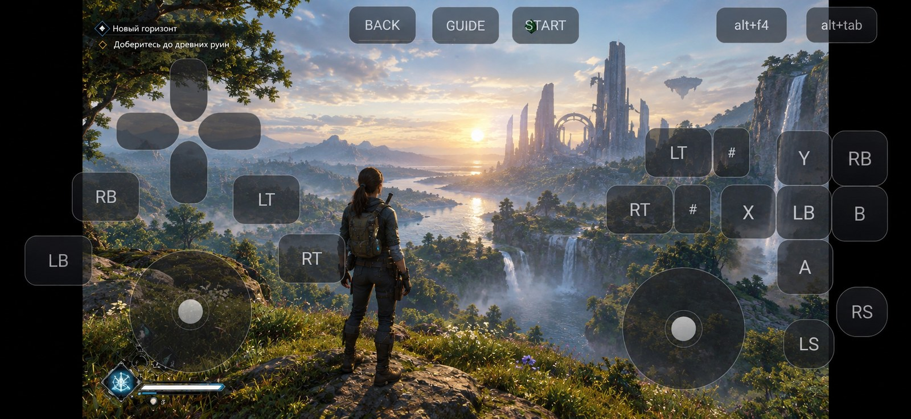
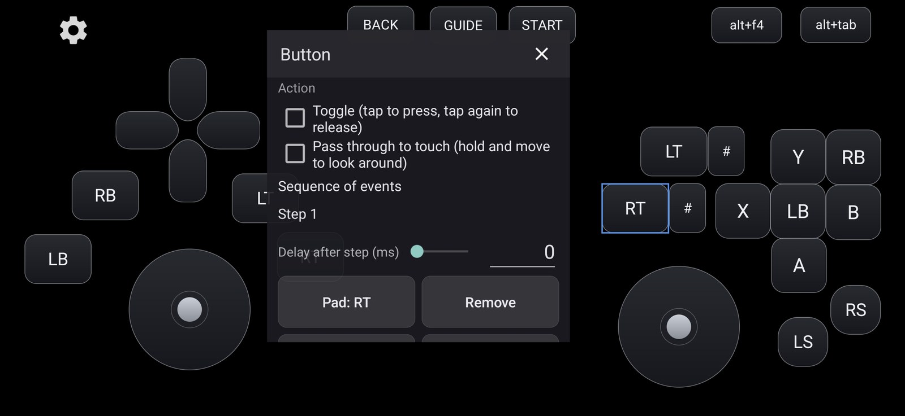
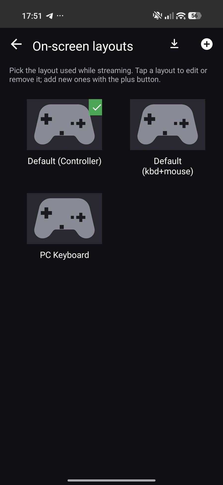
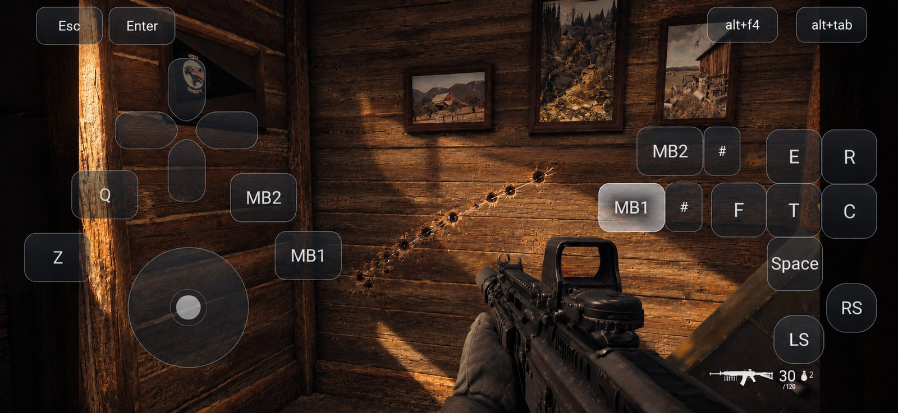
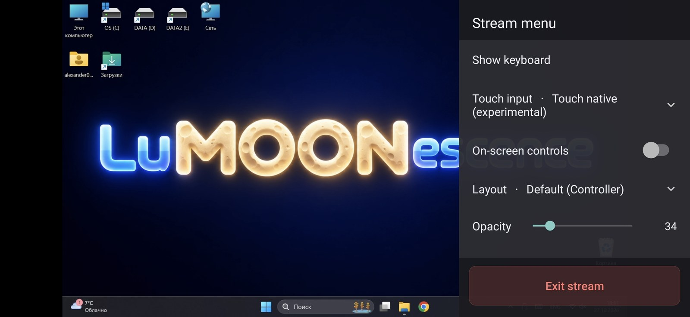
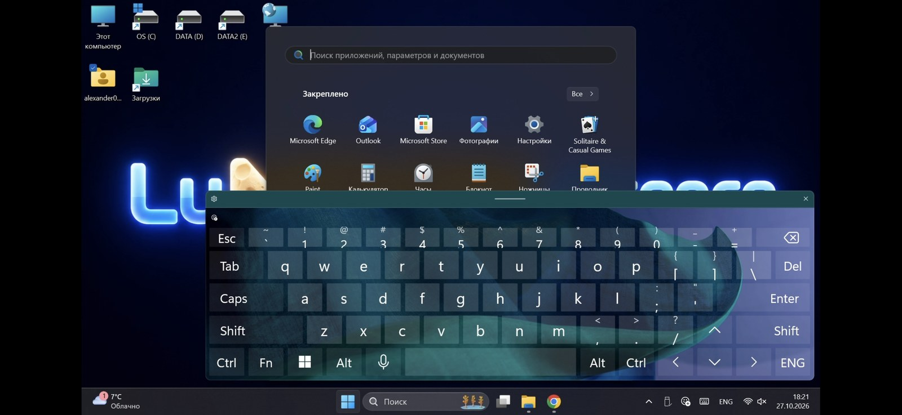

<p align="center">
  
</p>

<h3 align="center">Your Android phone is the keyboard, the mouse and the gamepad for your PC.</h3>

<p align="center">
  <a href="LICENSE.txt"></a>
  
  
  
</p>

<p align="center">
  
</p>

**LuMOONescence** mirrors your Windows PC to your phone and gives you the controls to actually use it.
It is a streaming client for a desktop and for the games on it, with an on-screen layout you design
yourself: gamepad buttons, a full PC keyboard, mouse buttons, a trackpad, analog sticks — whatever
the thing you are doing needs.

There is nothing else to buy or carry. An Android device with a touchscreen is the whole controller.

> Based on [Moonlight for Android](https://github.com/moonlight-stream/moonlight-android), which is
> free software under the GPLv3. This is an independent project, not an official Moonlight build.

---

## Why a phone is enough

| What you want to do | How it works here |
|---|---|
| Use the desktop of the PC | Trackpad, direct cursor, or a real on-screen PC keyboard with mouse buttons |
| Play a game built for a gamepad | A layout of buttons and sticks over the video, drawn where your thumbs already are |
| Play a shooter built for keyboard and mouse | Keys on the left, mouse buttons on the right — with a hold-and-drag fire button |
| Set something up in the BIOS or launcher | The same, before anything is even running on the host |
| Have a different layout per game | Layout sets, chosen in the menu or from the layouts screen, switched mid-stream |

The host is somebody else's half of the story: [Sunshine](https://github.com/LizardByte/Sunshine) is
the recommended one on Windows (open source, works with NVIDIA, AMD and Intel), and NVIDIA GameStream
still works on hosts that have it.

---

## What the app brings

### An editor, not a fixed set of buttons

The layout is edited on the stream itself: drag a control, resize it from its corners, round its
corners, set its opacity. What you see while editing is exactly where the control will be while
playing, because the editor and the stream share the same screen coordinates.

<p align="center">
  
</p>

- **Any input on any control**: a gamepad button, another stick's axis, a trigger, a keyboard key, a
  mouse button, or a combination of them.
- **Sequences with delays**: press once, and the control sends its steps one after another
  (`A`, wait 120 ms, then `B`). A tap plays the whole sequence; holding a control keeps it all down.
- **Toggle** for controls that latch, and **pass through to touch** for controls that keep firing
  while the same finger looks around.
- **Layout sets**: as many as you like, exported and imported as a JSON file, so a layout can be
  shared or moved to another device.

<p align="center">
  
</p>

### Hold and drag: fire and aim with one thumb

A control with *pass through to touch* keeps its own press while the same finger moves across the
screen, so the shot keeps firing and the view keeps turning. It is the one thing a touchscreen
genuinely cannot do on its own.

<p align="center">
  
</p>

### Touch that behaves how you need it to

| Touch input | What the screen does |
|---|---|
| **Touchpad** | Moves the pointer like a laptop; a choice of *Trackpad*, *Direct cursor* or *No clicks* underneath |
| **Touch native** (experimental) | Sends real touch events, for a host that takes them |
| **Right stick**, **Left stick** | A stick appears wherever the finger lands and is pushed by dragging away from it |
| **Off** | The screen only carries the layout, nothing else |

**Sensitivity** is a slider for the touchpad and for the sticks, separately, 20 % to 300 % — from
quick turns with a short swipe to precise aim. **Vibration** passes the game's rumble to the phone.

### A side menu instead of a trip to the settings

The back button opens a menu over the stream: keyboard, touch input, touchpad mode, sensitivity,
on-screen controls, layout, opacity, extras and the way out. Everything in it applies at once, so a
stream never has to be dropped to change how it feels.

<p align="center">
  
</p>

### Three layouts are there from the first launch

| Layout | What it is for |
|---|---|
| **Default (Controller)** | A whole gamepad: D-pad, face and shoulder buttons, triggers, both sticks |
| **Default (kbd+mouse)** | Keys around a stick and mouse buttons under the right thumb — for a desktop and for keyboard-and-mouse games |
| **PC Keyboard** | A full PC keyboard with mouse buttons where the thumb rests (88 keys) |

All three can be edited, duplicated and deleted. The built-in one is always there to fall back to.

<p align="center">
  
</p>

---

## Requirements

- **An Android device with a touchscreen**, Android 5.0 or newer. No root.
- **A host PC**: Windows with [Sunshine](https://github.com/LizardByte/Sunshine) (recommended) or
  NVIDIA GameStream.
- Both on the same network for a local stream, or a way for the two to reach each other for streaming
  over the internet.

## Install

Builds are published on the [releases page](https://github.com/alexander0ezhov/LuMOONescence/releases).
The app is signed with its own key, so it installs beside an official Moonlight build rather than
over it.

## Build from source

```powershell
git submodule update --init --recursive
$env:JAVA_HOME='C:\Program Files\Android\Android Studio\jbr'
.\gradlew.bat :app:assembleNonRootRelease
```

The APK lands in `app/build/outputs/apk/nonRoot/release/`. The `root` flavour exists for Android 7
and older devices that need the rooted input driver; on newer devices it is not needed.

---

## Support the project

*Coming soon.* A link will appear here for anyone who wants to keep the project going.

## License

LuMOONescence is free software under the **GNU General Public License v3** — the full text is in
[LICENSE.txt](LICENSE.txt), and the licenses of everything it is built from are in
[NOTICE.md](NOTICE.md) and inside the app under **Settings → About → Open source licenses**.

The complete source of every published build lives in this repository, at the tag that matches the
build. You are free to use, study, share and change it — and if you pass a build on, the source goes
with it.

## Disclaimer

This program is distributed in the hope that it will be useful, but **without any warranty**; without
even the implied warranty of merchantability or fitness for a particular purpose. Sections 15 and 16
of the GPLv3 are the full text of that.

It is an independent project: not made, endorsed, sponsored or supported by NVIDIA Corporation or by
the Moonlight project. GameStream is a feature of NVIDIA's software; the Moonlight name and logo
belong to the Moonlight project. Stream only what you have the right to stream, and follow the terms
that come with your games and with your own computer.

## Credits

- [Moonlight for Android](https://github.com/moonlight-stream/moonlight-android) by Cameron Gutman and
  the Moonlight contributors — the client this is built on. Its original README is kept in
  [README-Moonlight.md](README-Moonlight.md).
- [moonlight-common-c](https://github.com/moonlight-stream/moonlight-common-c) — the streaming core.
- [Sunshine](https://github.com/LizardByte/Sunshine) — the open source host most people will use.
- The libraries listed in [NOTICE.md](NOTICE.md), and their authors.
