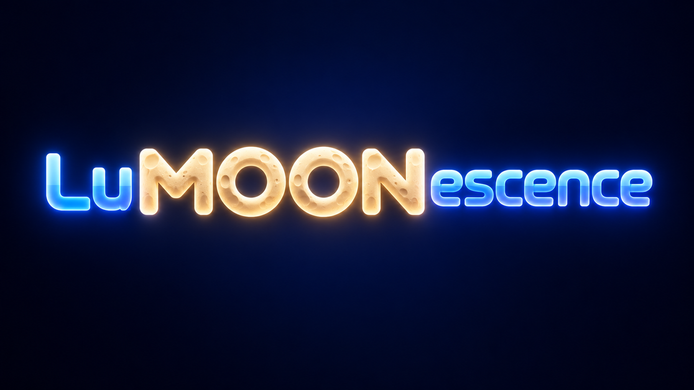
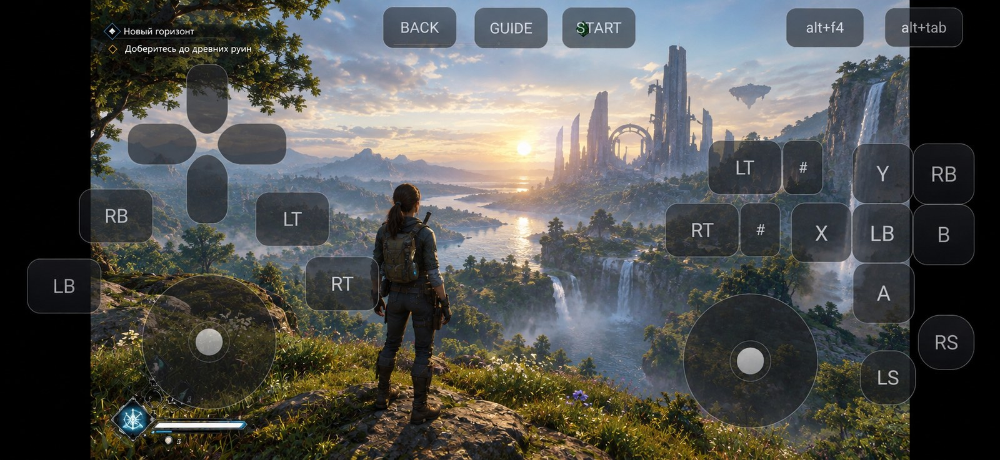
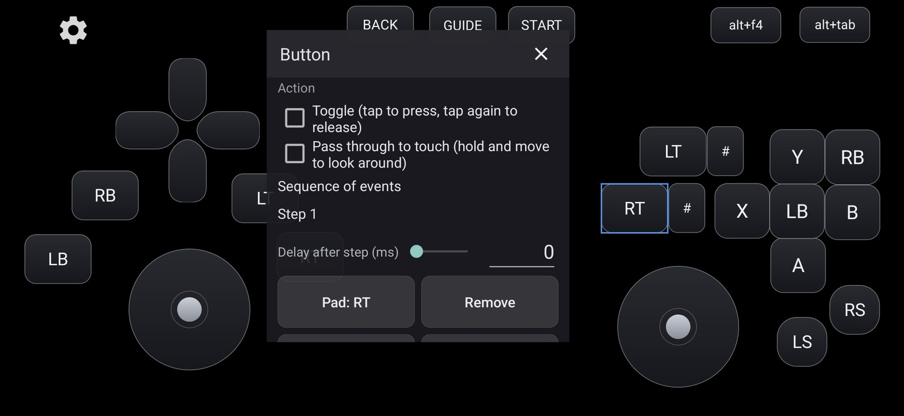
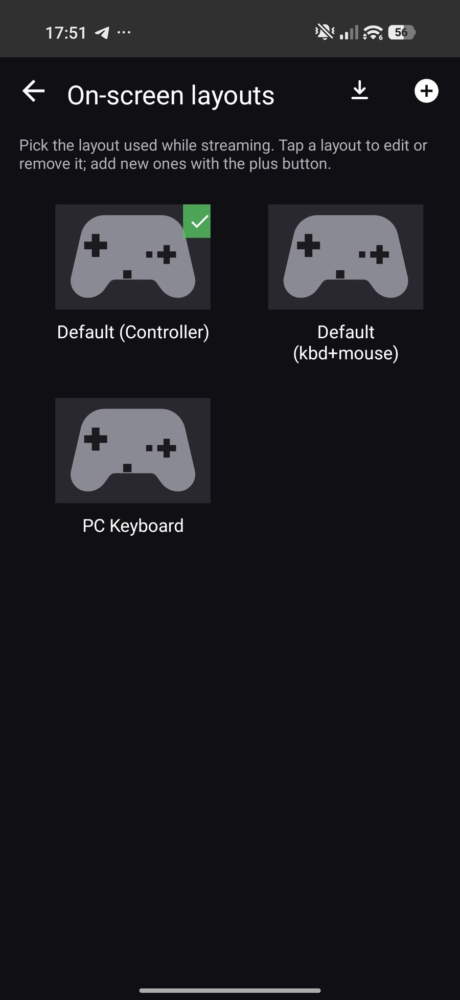
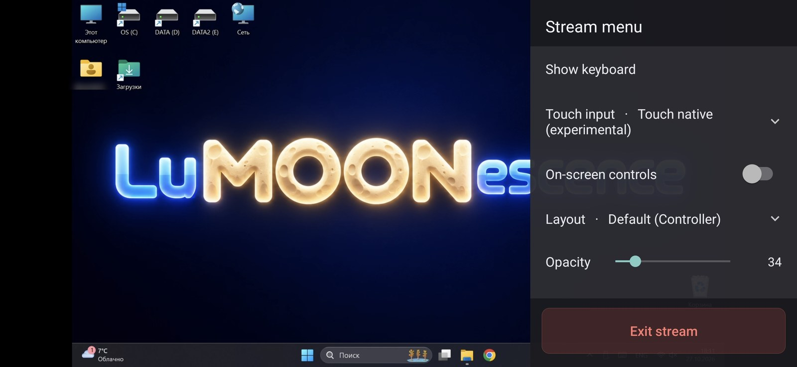
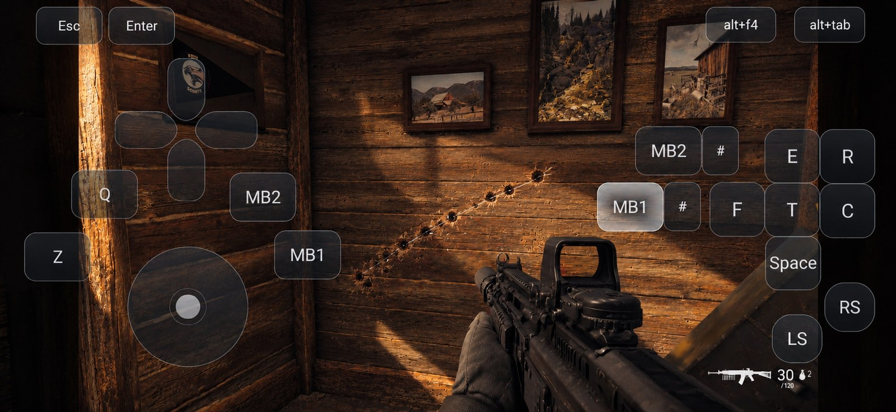
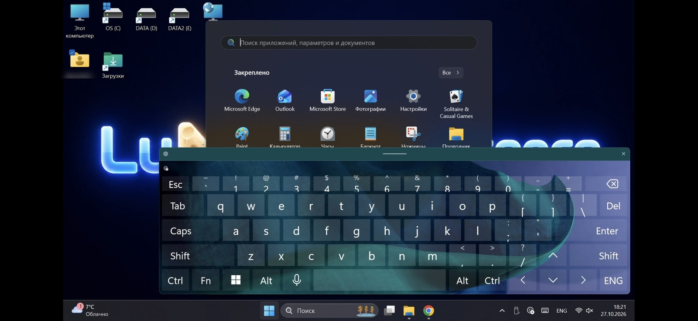

<p align="center">
  
</p>

<p align="center">
  <b>English</b> · <a href="README.ru.md">Русский</a>
</p>

<h3 align="center">Your smartphone is the one device you need to run your PC: a keyboard, a mouse and a gamepad in one.</h3>

<p align="center">
  <a href="LICENSE.txt"></a>
  
  
  
</p>

<p align="center">
  
</p>

**LuMOONescence** mirrors your PC on your phone and gives you controls that are actually usable. It is
a streaming client for a desktop and for the games on it, with on-screen layouts you arrange
yourself: gamepad buttons, PC keys, mouse buttons, a trackpad, sticks, native touch input — or all of
them at once. Whatever the thing you are doing needs.

There is no pile of devices to carry around any more. An Android phone with a touchscreen is the
whole controller.

> Based on [Moonlight for Android](https://github.com/moonlight-stream/moonlight-android), which is
> free software under the GPLv3. This is an independent project, not an official Moonlight build.

---

## What you can do

| What you want to do | How it works here |
|---|---|
| Actually work on the PC | Trackpad, native touch input, text from the Android keyboard — or a real on-screen PC keyboard with mouse buttons |
| Play games made for a gamepad | Buttons and sticks over the stream, drawn where your thumbs already are |
| Play shooters built for keyboard and mouse | Keys and mouse buttons, with a hold-and-drag mode: fire and aim with one thumb at the same time |
| Have a different layout per game | Layout sets switch on the fly, from the side menu or from the layouts screen |

The host is the other half of the story: on Windows, [Sunshine](https://github.com/LizardByte/Sunshine)
is the recommended one (open source, works with NVIDIA, AMD and Intel), and NVIDIA GameStream still
works where it exists.

---

## What the app does

### An editor, not a fixed set of buttons

The layout is edited on the stream itself: the size and position of a control, its corner radius, its
opacity, and the actions it sends, including combinations of them. The editor works on the same
screen and in the same coordinates as the game, so a control sits exactly where it will sit while
playing.

<p align="center">
  
</p>

- **Any input on any control**: a gamepad button, an axis, a trigger, a keyboard key, a mouse button —
  and combinations of them. A stick can send keys as well, not only an axis deflection.
- **Sequences with delays**: press once, and the control sends its steps one after another
  (`A`, wait 120 ms, then `B`). A tap plays the whole sequence; holding a control keeps it all down.
- **A toggle** for controls that have to stay on after a touch, and **pass through to touch** for
  hold-and-drag.
- **Layout sets**: as many as you like, exported and imported as a JSON file, so a layout can be
  shared or moved to another device.

<p align="center">
  
</p>

### Several input modes for a finger moving across the screen

| Touch input | What the screen does |
|---|---|
| **Touchpad** | Moves the pointer like a laptop; three variants — *Trackpad*, *Direct cursor* (the cursor is where the finger is) and *No clicks* (handy in shooters, so nothing fires by accident) |
| **Touch native** (experimental for now) | Sends real touch events, for a host that takes them |
| **Right stick**, **Left stick** | A stick appears wherever the finger lands and is pushed by dragging away from it |
| **Off** | The screen only carries the layout, nothing else |

**Sensitivity** is a slider for the touchpad and for the sticks, separately, 20 % to 300 % — from
quick turns with a short swipe to precise aim. **Vibration** passes the game's rumble to the phone.

### A side menu instead of the settings

The back button opens a menu over the stream: keyboard (the Android one), touch input, touchpad
mode, sensitivity, on-screen controls, the layout, opacity, extras. Everything in it applies at once,
so a stream never has to be dropped.

<p align="center">
  
</p>

### Hold and drag: fire and aim with one thumb

A control with *pass through to touch* keeps its own press while the same finger moves across the
screen, so the shot keeps firing and the view keeps turning. It works together with whichever touch
mode is chosen in the side menu.

<p align="center">
  
</p>

### Three layouts are there from the first launch

| Layout | What it is for |
|---|---|
| **Default (Controller)** | A whole gamepad: D-pad, face and shoulder buttons, triggers, both sticks |
| **Default (kbd+mouse)** | Keys around a stick and mouse buttons under the right thumb — for a desktop and for keyboard-and-mouse games |
| **PC Keyboard** | A PC keyboard with mouse buttons (88 keys) |

All of them can be edited, duplicated and deleted. The built-in one is always there to fall back to.

<p align="center">
  
</p>

---

> **Before your first stream.** Open the settings and set the resolution and, above all, the bitrate
> for your network: the higher the bitrate, the better the picture and the harder the network has to
> work.

---

## Requirements

- **An Android device with a touchscreen**, Android 5.0 or newer. No root.
- **A host PC**: Windows with [Sunshine](https://github.com/LizardByte/Sunshine) (recommended) or
  NVIDIA GameStream.
- Both on the same network for a local stream, or a way for the two to reach each other for streaming
  over the internet.

## Install

Builds are published on the [releases page](https://github.com/alexander0ezhov/LuMOONescence/releases).
The app is signed with its own key, so it installs beside an official Moonlight build rather than
over it.

## Build from source

```powershell
git submodule update --init --recursive
$env:JAVA_HOME='C:\Program Files\Android\Android Studio\jbr'
.\gradlew.bat :app:assembleNonRootRelease
```

The APK lands in `app/build/outputs/apk/nonRoot/release/`. The `root` flavour exists for Android 7
and older devices that need the rooted input driver; on newer devices it is not needed.

---

## Support the author

The project is free, open source, and stays that way — nothing is behind a paywall and nothing will
be. If you feel like saying thanks anyway, a voluntary transfer is welcome:

<p align="center">
  <a href="https://yoomoney.ru/to/4100119676114070"></a>
</p>

<p align="center">
  <code>https://yoomoney.ru/to/4100119676114070</code>
</p>

There is also a [support page](https://alexander0ezhov.github.io/LuMOONescence/donate.html) with the
same transfer and the YooMoney widget.

**This is a gift.** The transfer is voluntary and without any obligation: it is not a payment for a
product, a service or a subscription, and it gives no extra features, priorities or advantages.
Whether to send anything, and how much, is entirely up to you.

## License

LuMOONescence is free software under the **GNU General Public License v3** — the full text is in
[LICENSE.txt](LICENSE.txt).

Everything it is built from keeps its own license: moonlight-common-c (GPL v3), OpenSSL (Apache 2.0),
Opus (BSD 3-Clause), okhttp and jmdns (Apache 2.0), Bouncy Castle (MIT), JCodec (BSD 2-Clause) and
ShieldControllerExtensions (MIT). The complete text of all of them is inside the app under
**Settings → About → Open source licenses**, and [NOTICE.md](NOTICE.md) lists the versions that go
into a build.

The complete source of every published build lives in this repository, at the tag that matches the
build — [RELEASING.md](RELEASING.md) describes how that is kept true. You are free to use, study,
share and change it — and if you pass a build on, the source goes with it.

## Disclaimer

This program is distributed in the hope that it will be useful, but **without any warranty**; without
even the implied warranty of merchantability or fitness for a particular purpose. Sections 15 and 16
of the GPLv3 are the full text of that.

It is an independent project: not made, endorsed, sponsored or supported by NVIDIA Corporation or by
the Moonlight project. GameStream is a feature of NVIDIA's software; the Moonlight name and logo
belong to the Moonlight project. Stream only what you have the right to stream, and follow the terms
that come with your games and with your own computer.

## Credits

- [Moonlight for Android](https://github.com/moonlight-stream/moonlight-android) by Cameron Gutman and
  the Moonlight contributors — the client this is built on. Its original README is kept in
  [README-Moonlight.md](README-Moonlight.md).
- [moonlight-common-c](https://github.com/moonlight-stream/moonlight-common-c) — the streaming core.
- [Sunshine](https://github.com/LizardByte/Sunshine) — the open source host most people will use.
- The libraries listed in [NOTICE.md](NOTICE.md), and their authors.
