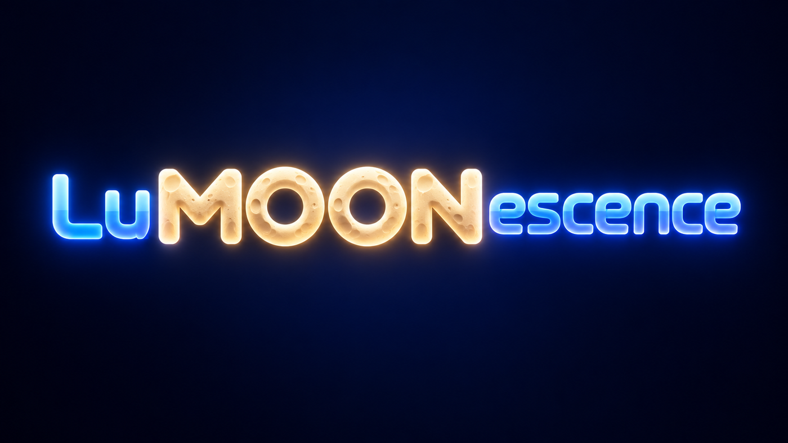
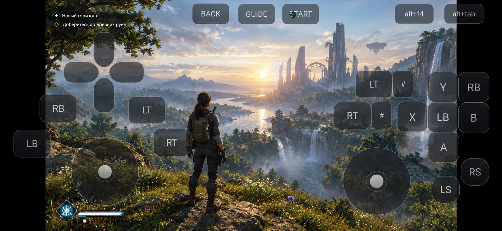
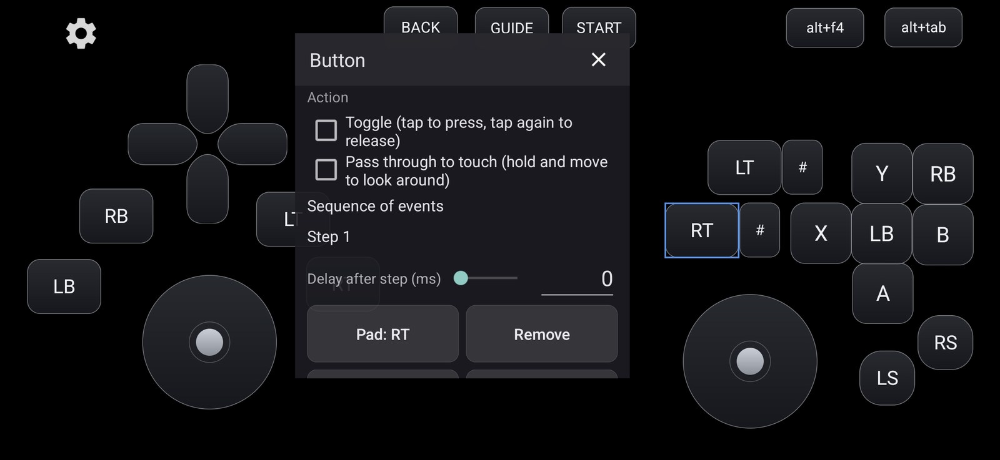
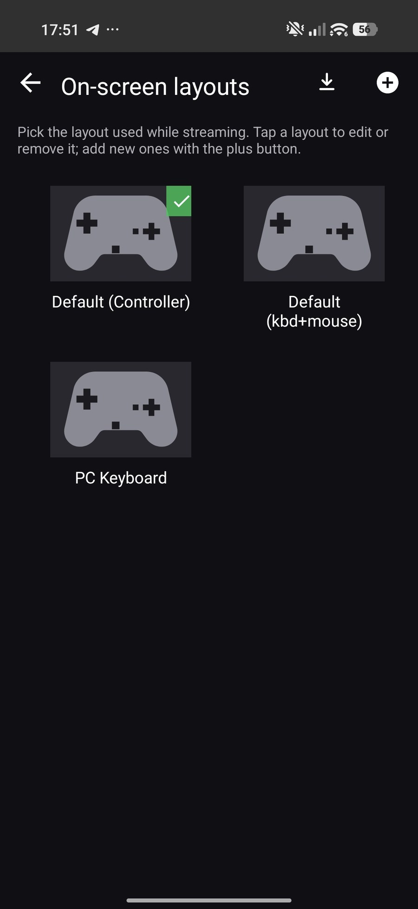
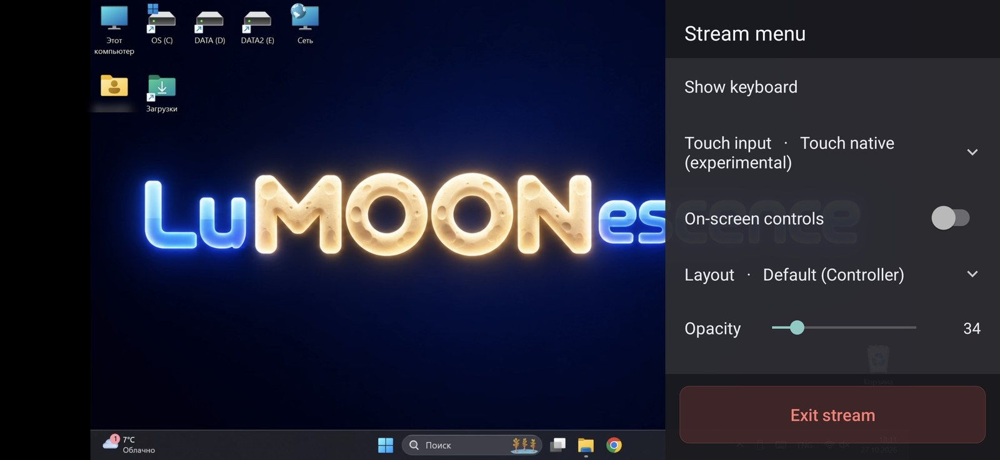
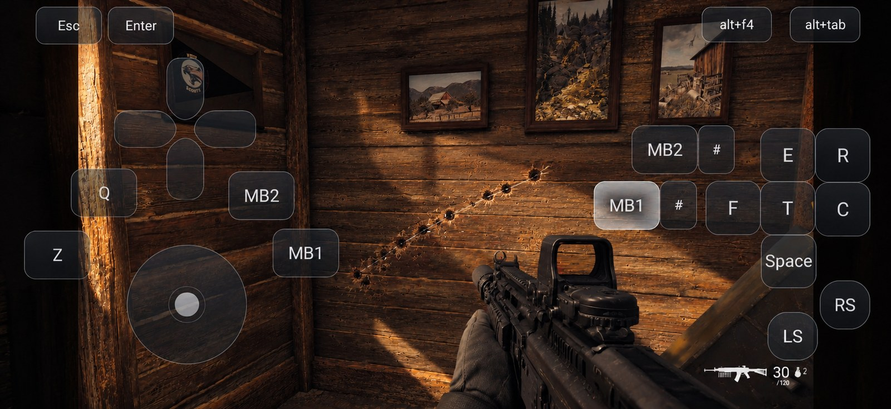
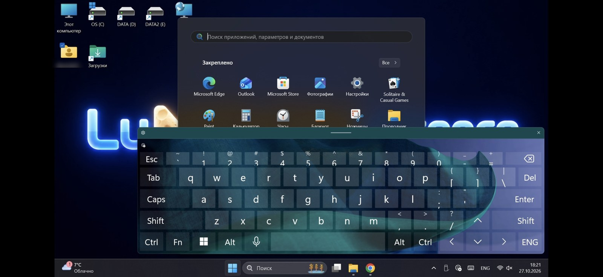

<p align="center">
  
</p>

<p align="center">
  <a href="README.md">English</a> · <b>Русский</b>
</p>

<h3 align="center">Твой смартфон — это универсальное устройство для управления ПК: клавиатура, мышь и геймпад в одном.</h3>

<p align="center">
  <a href="LICENSE.txt"></a>
  
  
  
</p>

<p align="center">
  
</p>

**LuMOONescence** показывает экран твоего ПК на телефоне и даёт управление, которым действительно
можно пользоваться. Это клиент трансляции для рабочего стола и для игр на нём — с экранными
раскладками, которые ты настраиваешь сам: кнопки геймпада, клавиши ПК, кнопки мыши, тачпад, стики,
нативный сенсорный ввод или всё сразу. Всё, что нужно для конкретной задачи.

Больше не нужно носить с собой кучу устройств. Android-смартфон с сенсорным экраном — это весь
контроллер.

> Основано на [Moonlight for Android](https://github.com/moonlight-stream/moonlight-android), который
> распространяется по GPLv3. Это независимый проект, а не официальная сборка Moonlight.

---

## Возможности

| Что можно сделать                                | Как это работает |
|--------------------------------------------------|---|
| Полноценно работать за ПК                        | Тачпад, нативный сенсорный ввод, ввод текста с системной клавиатуры Android — или настоящая экранная клавиатура с кнопками мыши |
| Играть в игры через сенсорную раскладку геймпада | Кнопки и стики поверх трансляции — там, где уже лежат пальцы |
| Играть в шутеры под клавиатуру и мышь            | Клавиши и кнопки мыши, с режимом «нажми и веди»: стрельба и обзор одним пальцем одновременно |
| Иметь свою раскладку под каждую игру             | Наборы раскладок переключаются на ходу: в боковом меню или на экране раскладок |

Для работы нужно хостовое приложение на стороне ПК: на Windows рекомендуется
[Sunshine](https://github.com/LizardByte/Sunshine) (открытый, работает с NVIDIA, AMD и Intel), а
NVIDIA GameStream тоже работает там, где он есть.

---

## Что умеет приложение

### Редактор, а не фиксированный набор кнопок

Раскладка редактируется прямо на трансляции: размер и положение контролов, скругление углов,
прозрачность, действия и их комбинации. Редактор работает на том же экране и в тех же координатах,
что и игра, поэтому контрол стоит ровно там, где окажется при игре.

<p align="center">
  
</p>

- **Любой ввод на любой контрол**: кнопка геймпада, ось, триггер, клавиша клавиатуры, кнопка мыши —
  и комбинации из них. Стик тоже может отправлять клавиши, а не только отклонение оси.
- **Последовательности с задержками**: одно нажатие — и контрол отправляет шаги друг за другом
  (`A`, пауза 120 мс, затем `B`). Тап доигрывает последовательность целиком, удержание держит всё.
- **Переключатель** для кнопок, которые должны оставаться включёнными после касания, и **сквозной
  нажим** для режима «нажми и веди».
- **Наборы раскладок**: сколько угодно, экспорт и импорт в JSON — раскладку можно передать другому
  человеку или перенести на другое устройство.

<p align="center">
  
</p>

### Множество режимов ввода при движении пальцем по экрану

| Режим касаний | Что делает экран                                                                                                                                                         |
|---|--------------------------------------------------------------------------------------------------------------------------------------------------------------------------|
| **Тачпад** | Двигает курсор как на ноутбуке; есть три варианта — *Обычный*, *Курсор за пальцем* (курсор там, где палец) и *Без кликов* (удобно в шутерах, чтобы не стрелять случайно) |
| **Настоящие касания** (пока экспериментально) | Отправляет реальные touch-события, если хост их принимает                                                                                                                |
| **Правый стик**, **Левый стик** | Стик появляется там, где коснулся палец, и отклоняется движением от центра                                                                                               |
| **Выключен** | Отсутствие действий                                                                                                                                                      |

**Чувствительность** — отдельный слайдер для тачпада и для стиков, от 20 % до 300 %: от быстрых
поворотов коротким свайпом до точного прицеливания. **Вибрация** передаёт отдачу игры на телефон.

### Боковое меню вместо настроек

Кнопка «назад» открывает меню инструментов поверх трансляции: клавиатура (системная, Android), ввод касанием,
режим тачпада, чувствительность, экранные кнопки, выбор раскладки, прозрачность, «Дополнительно».
Все изменения применяются на лету.

<p align="center">
  
</p>

### Нажми и веди: стрельба и обзор одним пальцем

Кнопка со сквозным нажимом держит собственное нажатие, пока тот же палец ведёт по экрану —
выстрел продолжается, обзор продолжает поворачиваться. Работает вместе с тем режимом касаний,
который выбран в боковом меню.

<p align="center">
  
</p>

### Три предустановленные раскладки с первого запуска

| Раскладка | Для чего |
|---|---|
| **Default (Controller)** | Полный геймпад: D-pad, кнопки, бамперы, триггеры, оба стика |
| **Default (kbd+mouse)** | Клавиши вокруг стика и кнопки мыши под правым большим пальцем — для рабочего стола и игр под клавиатуру с мышью |
| **PC Keyboard** | Клавиатура ПК с кнопками мыши (88 клавиш) |

Любую из них можно изменить, продублировать и удалить. Встроенная всегда остаётся как запасной
вариант.

<p align="center">
  
</p>

---

> **Совет перед первой трансляцией.** Зайдите в настройки приложения и выставьте разрешение экрана и,
> главное, битрейт под свою сеть: чем выше битрейт — тем лучше картинка, но тем больше нагрузка на
> сеть.

---

## Требования

- **Android-устройство с сенсорным экраном**, Android 5.0 или новее. Root не нужен.
- **Хост-ПК**: Windows с [Sunshine](https://github.com/LizardByte/Sunshine) (рекомендуется) или
  NVIDIA GameStream.
- Оба устройства в одной сети для локальной трансляции — или способ, которым они видят друг друга
  при трансляции через интернет.

## Установка

Сборки публикуются на [странице релизов](https://github.com/alexander0ezhov/LuMOONescence/releases).
Приложение подписано собственным ключом, поэтому ставится рядом с официальным Moonlight, а не
поверх него.

## Сборка из исходников

```powershell
git submodule update --init --recursive
$env:JAVA_HOME='C:\Program Files\Android\Android Studio\jbr'
.\gradlew.bat :app:assembleNonRootRelease
```

APK появится в `app/build/outputs/apk/nonRoot/release/`. Флейвор `root` существует для Android 7 и
старше, где нужен root-драйвер ввода; на новых устройствах он не нужен.

---

## Поддержать автора

Проект бесплатный, с открытым кодом, и таким останется: ничего не спрятано за оплатой и не будет
спрятано. Если всё же хочется сказать спасибо — добровольный перевод приветствуется.

**Озон Банк (СБП, «чаевые»)** — данные карты вводить не нужно, достаточно отсканировать код
банковским приложением:

<p align="center">
  
</p>

<p align="center">
  <a href="https://finance.ozon.ru/apps/sbp/ozonbankpay/01a1a460-5092-7115-bde0-b09f11921a3b">Открыть в приложении банка</a>
</p>

**YooMoney** — перевод по ссылке:

<p align="center">
  <a href="https://yoomoney.ru/to/4100119676114070"></a>
</p>

<p align="center">
  <code>https://yoomoney.ru/to/4100119676114070</code>
</p>

Есть и [страница поддержки](https://alexander0ezhov.github.io/LuMOONescence/donate.html) — оба способа
в одном месте.

**Это подарок.** Перевод добровольный и безвозмездный: он не является оплатой товара, услуги или
подписки и не даёт дополнительных функций, приоритетов или преимуществ. Переводить или нет и
сколько — целиком на ваше усмотрение.

## Лицензия

LuMOONescence — свободное ПО по **GNU General Public License v3**, полный текст в
[LICENSE.txt](LICENSE.txt).

Всё, из чего оно собрано, сохраняет свою лицензию: moonlight-common-c (GPL v3), OpenSSL (Apache 2.0),
Opus (BSD 3-Clause), okhttp и jmdns (Apache 2.0), Bouncy Castle (MIT), JCodec (BSD 2-Clause) и
ShieldControllerExtensions (MIT). Полные тексты всех лицензий — в приложении:
**Настройки → О приложении → Лицензии открытого кода**; в [NOTICE.md](NOTICE.md) перечислены версии,
которые входят в сборку.

Полные исходники каждой опубликованной сборки лежат в этом репозитории под тегом, который
соответствует сборке — как это поддерживается, описано в [RELEASING.md](RELEASING.md). Вы можете
использовать, изучать, распространять и изменять проект; если передаёте сборку дальше — исходники
идут вместе с ней.

## Отказ от ответственности

Программа распространяется в надежде, что она будет полезна, но **без каких-либо гарантий**, в том
числе без подразумеваемых гарантий товарной пригодности и пригодности для конкретной цели. Разделы
15 и 16 GPLv3 — полный текст этого отказа.

Это независимый проект: он не сделан, не одобрен, не спонсируется и не поддерживается NVIDIA
Corporation или проектом Moonlight. GameStream — функция программ NVIDIA; имя и логотип Moonlight
принадлежат проекту Moonlight. Транслируйте только то, на что у вас есть право, и соблюдайте
условия, приложенные к вашим играм и к вашему компьютеру.

## Благодарности

- [Moonlight for Android](https://github.com/moonlight-stream/moonlight-android) — Cameron Gutman и
  участники Moonlight: клиент, на котором всё построено. Оригинальный README сохранён в
  [README-Moonlight.md](README-Moonlight.md).
- [moonlight-common-c](https://github.com/moonlight-stream/moonlight-common-c) — ядро трансляции.
- [Sunshine](https://github.com/LizardByte/Sunshine) — открытый хост, которым будет пользоваться
  большинство.
- Библиотеки из [NOTICE.md](NOTICE.md) и их авторы.
